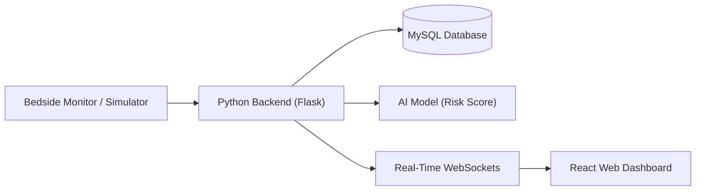

# 🏥 CareWatch: AI ICU Patient Monitor

> **Notice:** This is a **demonstration and research prototype**. It uses simulated (synthetic) data to show how real-time ICU monitoring and AI early warning work. It is **not** for actual hospital patient care.

---

## 💡 What is CareWatch?

**CareWatch** is a smart ICU monitoring dashboard. It helps doctors and nurses watch patient vital signs (like heart rate and blood pressure) in real time. It also uses machine learning to highlight when a patient might need extra attention.

### ✨ What can it do?
- 💓 **Live Vitals Streaming:** Watch Heart Rate, SpO2 (Oxygen), Blood Pressure, Respiratory Rate, and Temperature update live on screen without refreshing the page.
- 🤖 **AI Early Warning:** An experimental AI model analyzes the last 10 readings and gives an easy-to-read risk score (0 to 100%).
- 🚨 **Smart Alerts:** Warns staff if vitals cross safe limits (like tachycardia or hypoxia), with options to acknowledge, snooze, or escalate.
- 🛏️ **Bed Management:** See which ICU beds are occupied, available, or under maintenance.

---

## 🚀 How to Run the App (Quick Setup)

### What you need:
1. **Python 3.12+**
2. **Node.js 20+**
3. **MySQL 8.0** running locally on port `3306`

---

### Step 1: Start the Backend (Terminal 1)
Open PowerShell and run:

```powershell
cd "d:\work\Care Watch\backend"
$env:PYTHONPATH="."
.\venv\Scripts\python.exe wsgi.py
```
> The backend will start on **`http://127.0.0.1:5000`**.

---

### Step 2: Start the Frontend (Terminal 2)
Open a new PowerShell window and run:

```powershell
cd "d:\work\Care Watch\frontend"
npm run dev
```
> Open your browser and go to **`http://localhost:5173`**.

---

## 🔑 Login Accounts (Ready to Use)

You can log in with any of these pre-configured demo accounts:

| Role | Email | Password | What they can do |
| :--- | :--- | :--- | :--- |
| **Doctor** | `doctor.smith@carewatch.local` | `Password#123` | Full access: view patients, AI scores, alerts, audit logs |
| **Nurse** | `nurse.jack@carewatch.local` | `Password#123` | Clinical access: monitor patients, acknowledge alerts |
| **Admin** | `admin@carewatch.local` | `Password#123` | System management: audit logs, user management |

---

## 🖥️ How It Works (Simple Architecture)



1. **Simulator**: Creates realistic patient vital signs (Normal, High Heart Rate, Low Oxygen, or Septic Shock).
2. **Backend**: Validates the numbers, saves them in MySQL, and runs them through the AI model.
3. **WebSockets**: Sends live updates instantly to the browser.
4. **React Dashboard**: Displays live cards, charts, and alert banners for doctors and nurses.

---

## 🧪 How to Run Tests

CareWatch includes a complete automated test suite for both backend and frontend.

### Run Backend Tests (81 tests)
```powershell
cd "d:\work\Care Watch\backend"
$env:PYTHONPATH="."
.\venv\Scripts\pytest.exe tests -q
```

### Run Frontend Tests (18 tests)
```powershell
cd "d:\work\Care Watch\frontend"
npm test
```

---

## 🛠️ Tech Stack

- **Backend:** Python, Flask, Flask-SocketIO (Real-Time WebSockets), SQLAlchemy ORM
- **Database:** MySQL 8.0
- **AI & Machine Learning:** Scikit-learn, XGBoost, Pandas, NumPy
- **Frontend:** React, Vite, Tailwind CSS, Recharts (graphs), Lucide Icons
- **Testing:** Pytest (Backend), Vitest & React Testing Library (Frontend)

---

## 🐳 Running with Docker

If you prefer using Docker:

```powershell
docker compose up --build
```
- Web App: `http://localhost:80`
- API Backend: `http://localhost:5000`
- MySQL: `localhost:3306`

---

## ⚠️ Important Disclaimer

This project is created strictly for **educational and research demonstrations**:
- All patient telemetry data is **synthetic** (generated by code).
- The AI predictions and alert thresholds are for **demonstration purposes only**.
- It is **not clinically certified** or validated for real medical diagnosis or treatment.
